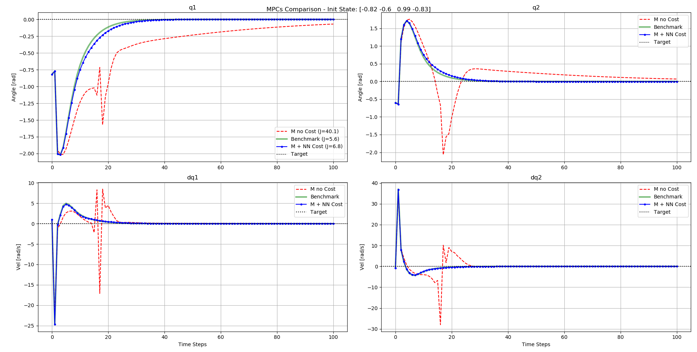
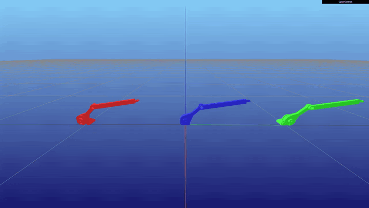
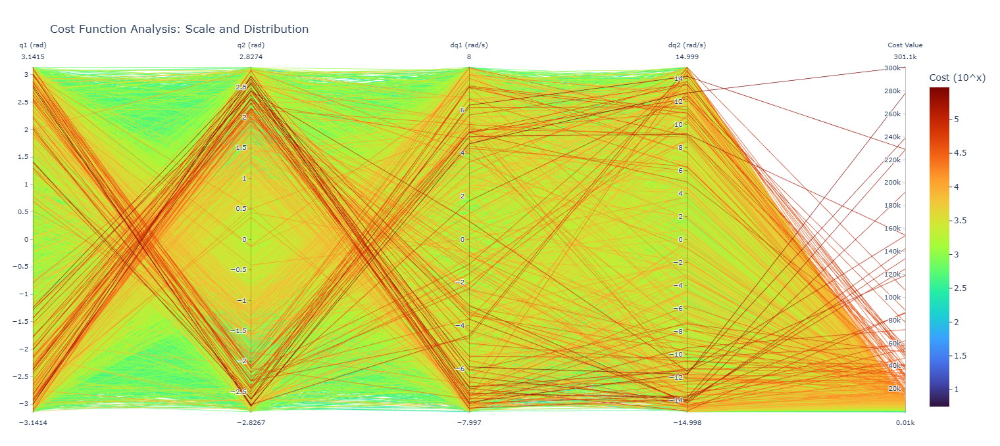
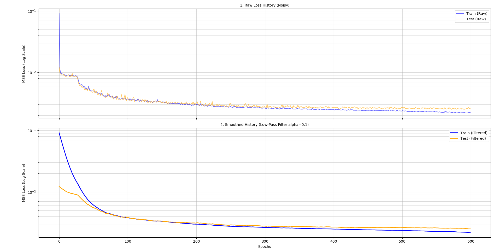

# Learning a Value Function as MPC Terminal Cost

A neural network learns the optimal **cost-to-go** (value function) of an **underactuated double pendulum**. The trained network is then used as the **terminal cost of a short-horizon MPC**, which lets the controller behave almost like a much longer-horizon MPC at a fraction of the computational cost.

> Final project (Assignment 03, option A: *Learning for Control*) for the **Advanced Optimization-Based Robot Control** course, University of Trento, Prof. Andrea Del Prete.
> Authors: **Alessandro Rossi**, **Lorenzo Franco**.
> 📄 Full report: [`Franco_Rossi_Report.pdf`](Franco_Rossi_Report.pdf) · Assignment: [`assignment.pdf`](assignment.pdf)

<p align="center">
  
</p>

---

## Demo

<p align="center">
  
  <br>
  <em>Swing-up from the same initial state: 🔴 short horizon (M = 14) without terminal cost · 🔵 short horizon + learned terminal cost · 🟢 long horizon (N + M = 114).</em>
</p>

More videos (click to watch on YouTube):

| Initial condition 1 | Initial condition 2 | Multiple runs |
|:---:|:---:|:---:|
| [](https://youtu.be/dTzMtQ39pxc) | [](https://youtu.be/vgQT7q9oPIk) | [](https://youtu.be/99hOP7C9648) |


---

## Problem

The double pendulum has state $\mathbf{x} = [q_1, q_2, \dot q_1, \dot q_2]^\top$. It is **underactuated**: only the first joint is actuated ($u = \tau_1$, $\tau_2 = 0$). The goal is to swing it up and stabilize it in the upright equilibrium $\mathbf{x}_{targ} = \mathbf{0}$.

The dynamics come from the robot URDF through [ADAM](https://github.com/ami-iit/adam), $\ddot{\mathbf q} = M(\mathbf q)^{-1}(\boldsymbol\tau - h(\mathbf q, \dot{\mathbf q}))$, and are discretized with explicit Euler ($\Delta t = 0.05$ s). The OCP minimizes a quadratic cost on the state and control errors:

$$
\min_{\mathbf X, \mathbf U} \sum_{k=0}^{N-1} (\mathbf x_k - \mathbf x_{targ})^\top W_x (\mathbf x_k - \mathbf x_{targ}) + (u_k - u_{targ})^\top W_u (u_k - u_{targ})
$$

## Pipeline

The project has three phases. Each one is a separate script.

### 1. Dataset generation (OCP)
The OCP above (horizon $N = 100$) is solved with CasADi + IPOPT for **10,000 random initial states**, in parallel over several processes. Each initial state and the optimal cost it produces are saved in a `.npz` file.

### 2. Neural network training
An MLP (4 → 256 → 256 → 1, `tanh` activations) is trained with PyTorch to predict the optimal cost from the initial state.
- Outliers (cost > 20,000) are removed.
- Targets are moved to log scale, $\ln(Y + 10^{-8})$, because costs span several orders of magnitude.
- Inputs and targets are normalized to $[-1, 1]$; the data is split 80/20 into training and test sets.

### 3. MPC comparison
The network is turned into a CasADi function and added as terminal cost $J(\mathbf x_M)$. Three controllers are compared:

| Case | Horizon | Terminal cost |
|---|---|---|
| 1 | $M = 14$ | none |
| 2 | $M = 14$ | **learned value function** |
| 3 | $N + M = 114$ | none (benchmark) |

---

## Results

Over **30 random initial states**:

- With the learned terminal cost (case 2) the MPC **performs better than case 1 in 25 out of 30 runs (83%)**.
- Case 2 **reaches the target in 27 out of 30 runs (90%)**, while the short-horizon MPC without terminal cost almost never does.
- Case 2 produces trajectories very close to the long-horizon benchmark (case 3), with a horizon about 8 times shorter.

| Dataset cost distribution | Training / test loss |
|:---:|:---:|
|  |  |

The full results table and the metrics used for the comparison are in the [report](Franco_Rossi_Report.pdf).

---

## Repository structure

```
.
├── Double_Pendulum/                          # Main project (described in the report)
│   ├── fase1_dataset_from_OCP_doub_pend.py   # 1. Solves the OCPs and generates the dataset
│   ├── fase2_network_training_doub_pend.py   # 2. Trains the value-function network
│   ├── fase3_MPC_results_comparison_duob_pend.py  # 3. Compares the three MPCs (+ Meshcat visualization)
│   ├── neural_network.py                     # Network definition
│   ├── dataset_cost_plot.py                  # Parallel-coordinates plot of the dataset
│   ├── pendulum_dataset_used.npz             # Dataset used in the report
│   └── value_function_model_used.pt          # Trained model used in the report
│
├── SimplePendulum/                           # First version on the single pendulum (same pipeline)
│
├── media/                                    # GIF used in this README
├── Report/                                   # LaTeX sources of the report
├── Franco_Rossi_Report.pdf                   # Final report
├── assignment.pdf                            # Assignment text
└── requirements.txt
```

---

## Installation

Requires **Python 3.10+**.

```bash
git clone https://github.com/AleRossiS/AOBRC_Project.git
cd AOBRC_Project
python -m venv venv
source venv/bin/activate        # Windows: venv\Scripts\activate
pip install torch
pip install -r requirements.txt
```

> `torch` is installed first because `l4casadi` (used only by the single-pendulum MPC) needs it at build time. If `l4casadi` fails to build, try `pip install l4casadi --no-build-isolation`. Pinocchio (`pin`) can also be installed with conda: `conda install -c conda-forge pinocchio`.

## Usage

Run the scripts in order, from the repository root:

```bash
python Double_Pendulum/fase1_dataset_from_OCP_doub_pend.py        # dataset generation (slow: 10,000 OCPs)
python Double_Pendulum/fase2_network_training_doub_pend.py        # training
python Double_Pendulum/fase3_MPC_results_comparison_duob_pend.py  # MPC comparison and plots
```

- The dataset and model used in the report are already in the repo (`*_used.npz`, `*_used.pt`), so you can **skip straight to phase 3**.
- Phase 1 saves the new dataset as `pendulum_dataset.npz` and phase 2 saves the new model as `value_function_model.pt`. Phases 2 and 3 read the `*_used` files by default: to use your own data, change `DATA_PATH` and `MODEL_PATH` at the top of the scripts.
- Phase 3 opens a **Meshcat** visualization in the browser to show the pendulum's motion.

The single-pendulum scripts in `SimplePendulum/` follow the same order.
